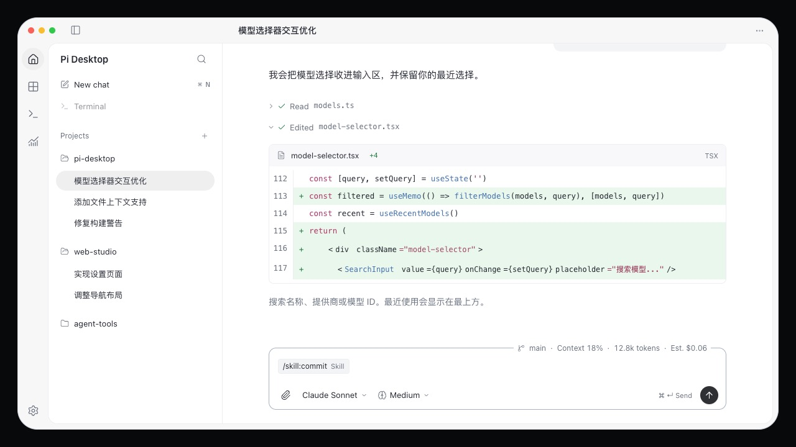
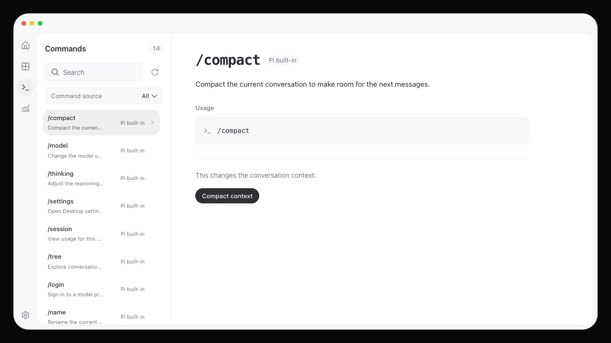
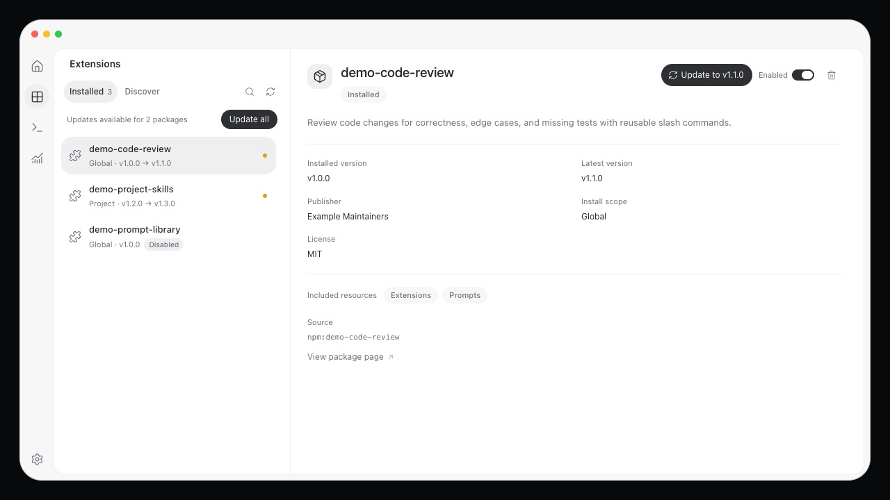
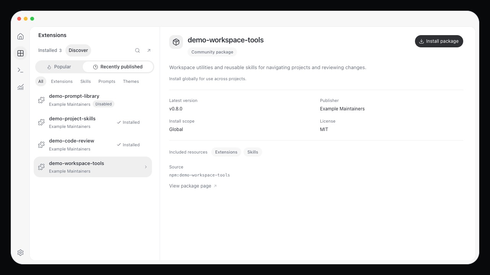
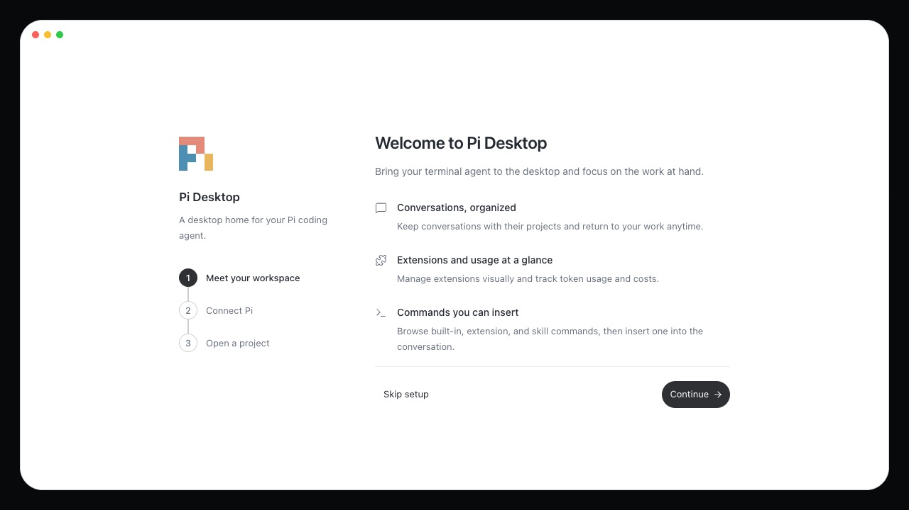

# Pi Desktop

Pi Desktop is a macOS workspace for the Pi coding agent. Keep each conversation with its project, follow streaming replies and code changes, and manage commands and extensions from one window.

The app connects to a local `pi` executable over JSONL RPC and uses the models and sign-in already configured for that installation.



## Features

- **Projects.** Open folders, create and switch conversations, search titles and message text, pin or rename a conversation, and export Markdown.
- **Conversations.** Streaming Markdown, highlighted code, expandable tool output, edit diffs, file attachments, and stop or retry controls.
- **Models.** Search by name, provider, or ID, return to recently used models, and set thinking effort.
- **Commands.** Browse Pi built-ins, extension commands, skills, and prompt templates. Search descriptions and sources, inspect usage, and insert a supported command into the draft.
- **Drafts.** Slash suggestions, editable command tags and arguments, copy and paste, undo and redo, and a draft saved per conversation.
- **Extensions.** Browse installed packages, discover npm packages, inspect versions and sources, install or remove them, enable or disable them, and check for updates.
- **Usage.** Context, token totals, estimated cost, and usage across sessions opened by the app.
- **Setup.** Check the Pi environment, set an executable path, choose a project or the default workspace, and reopen the guide from Settings.
- **Appearance.** Light, dark, and system themes, English and Simplified Chinese, and collapsible, resizable sidebars with native macOS window controls.

## Screenshots

### Commands

Open a command to read its description, usage, and the action available on the desktop. `/compact` compacts the current conversation.



### Extensions

Compare installed and latest versions, enable or disable a package, and update one package or all of them.



Discover sorts by popularity or publication date and filters extensions, skills, prompts, and themes. Publisher, license, included resources, and source are shown before install.



Package names, versions, publishers, and download counts in these two views are sample data. Nothing was installed or changed to capture them.

### First launch

The guide introduces the workspace, then checks Pi and prepares a project. Setup can be skipped and reopened later.



Screenshots are from the browser preview. The workspace image uses English interface labels and a Chinese sample conversation. Live agent replies run in the desktop app.

## Get started

### Requirements

- Node.js 22 or later
- pnpm, at the version declared in `package.json`
- Rust and the platform tools required by Tauri 2
- A local `pi` installation, with a configured model provider, for live agent work

```sh
pi --version
```

### Desktop app

```sh
pnpm install
pnpm desktop
```

The first launch looks for Pi and asks for a project folder, or offers the default workspace. **Skip setup** opens the app without connecting. The guide can be opened again from **Settings**.

Detection checks `PATH` and common install locations, including Volta and Homebrew. If Pi is not found, enter the executable’s absolute path in the guide or in Settings. Model lists and thinking levels come from the local Pi configuration.

**Add project**, next to Projects, opens another folder. Each project runs its own Pi process. Conversations in that project switch through `new_session` and `switch_session`. Coming back to a project reuses the process and restores its session. Quitting the app stops those child processes.

### Browser preview

```sh
pnpm dev
```

Open [http://127.0.0.1:1420](http://127.0.0.1:1420). The preview supplies sample sessions and models for the interface, search, drafts, and preferences. It does not generate model replies, run native environment checks, or call a package registry. The browser and desktop apps store preferences under different keys.

## Commands and drafts

The command list mixes built-in definitions with the resources loaded by the connected Pi process. Commands shown in the preview are fixtures.

| Command type                                   | On the desktop                                                              |
| ---------------------------------------------- | --------------------------------------------------------------------------- |
| `/compact`                                     | Compacts the current conversation through RPC.                              |
| `/settings`, `/model`, `/thinking`, `/session` | Opens the matching desktop view or control.                                 |
| Other Pi built-ins                             | Explains that the command belongs in the Pi terminal, and does not send it. |
| Extension commands, skills, prompt templates   | Inserts a tag into the draft so arguments can be reviewed before sending.   |

Type `/` in the composer to search. A tag keeps the resource identity and its arguments, and each conversation stores its own draft. Several tags can be edited, but sending more than one command in a single draft is rejected in the editor. Dispatch follows Pi’s command precedence.

Drafts and attachments survive a refresh. If saving fails, the in-memory draft stays in the editor and can be exported as a backup. Deleting a conversation removes the desktop record and its draft. Pi’s original session file is left in place.

Switching conversations is locked while an agent run is active, and unlocks after `agent_settled`, including automatic retries.

### Shortcuts

| Action                    | macOS       | Windows / Linux             |
| ------------------------- | ----------- | --------------------------- |
| New conversation          | `⌘ N`       | `Ctrl N`                    |
| Search                    | `⌘ K`       | `Ctrl K`                    |
| Toggle sidebar            | `⌘ B`       | `Ctrl B`                    |
| Send                      | `⌘ Enter`   | `Ctrl Enter`                |
| Conversation context menu | `Shift F10` | `Shift F10` or the Menu key |

Windows and Linux desktop behavior has not been validated.

## Develop

The app is Tauri 2, React, TypeScript, and Vite, with TanStack Router, Tailwind CSS 4, HeroUI 3, Zustand, ahooks, and Motion. The frontend is built to static assets for the desktop shell.

| Location                                              | What lives there                                                          |
| ----------------------------------------------------- | ------------------------------------------------------------------------- |
| `src/router`, `src/routes`                            | Typed routes, hash history, and lazy page routes.                         |
| `src/pages`                                           | Chat, commands, extensions, usage, settings, and onboarding.              |
| `src/layouts`, `src/hooks`                            | Workspace layout, shortcuts, dialogs, and desktop lifecycle.              |
| `src/components`                                      | Conversation rendering, navigation, controls, and overlays.               |
| `src/components/composer`                             | Draft editor, slash menu, tag editing, and editor events.                 |
| `src/components/extension-packages`                   | Extension library, package details, update checks, and actions.           |
| `src/styles`                                          | Theme tokens, Tailwind and HeroUI, and feature styles compiled from SCSS. |
| `src/store/workspace.ts`                              | Workspace state, preferences, drafts, and persistence.                    |
| `src/lib/desktop.ts`, `src/lib/desktop`               | Desktop API, startup recovery, RPC, events, and sending.                  |
| `src/lib/rpc.ts`                                      | Normalization for messages, tool results, diffs, and usage.               |
| `src-tauri/src/runtime.rs`                            | Local Pi processes, JSONL request matching, events, and cleanup.          |
| `src-tauri/src/packages.rs`, `src-tauri/src/packages` | Package configuration, registry access, and native package operations.    |
| `tests`, `src-tauri/tests`                            | Frontend, build-script, and Rust tests, grouped by source module.         |

### Language

On first load, a Chinese system locale selects Simplified Chinese. Any other locale, or an unavailable locale, selects English. A language chosen in the app is saved and wins on the next launch.

Strings live in `src/locales/en.ts` and `src/locales/zh.ts`. Use semantic keys such as `t('connection.connecting')`, and pass interpolation values such as `t('composer.sendHint', { shortcut: '⌘ ↵' })`. Type checking and tests cover keys and interpolation parameters. Native dialog labels and application errors follow the selected language. Text from the user, Pi, providers, and extensions is left as written.

### Checks

```sh
pnpm typecheck
pnpm lint
pnpm format:check
pnpm verify
cargo fmt --manifest-path src-tauri/Cargo.toml -- --check
cargo clippy --manifest-path src-tauri/Cargo.toml --all-targets --all-features --locked -- -D warnings
cargo test --manifest-path src-tauri/Cargo.toml --locked
pnpm build
```

`typecheck` covers the frontend, build scripts, and tests. `verify` runs `tests/**/*.test.ts`. JavaScript and TypeScript use oxlint and oxfmt. Rust uses rustfmt. `pnpm lint:fix` and `pnpm format` apply the automatic fixes.

Command compatibility tests target Pi CLI 1.0.0 with an isolated installation, a temporary configuration, and a local simulated model endpoint. Those version-specific tests stay skipped in the normal suites and have to be turned on separately. Installation and the `pnpm verify:pi-v1` command are documented in the [Pi 1.0.0 compatibility guide](docs/implementation/pi-v1-compatibility.md).

## Release

Build a local macOS app and DMG:

```sh
pnpm package:mac
```

The DMG is written to `src-tauri/target/release/bundle/dmg/`.

The GitHub Actions **build** workflow is started by hand from **Actions → build → Run workflow**. Choose a branch and a SemVer version without a `v` prefix, such as `0.2.0` or `0.2.0-beta.1`.

The workflow runs the quality checks, builds a universal macOS DMG for Apple Silicon and Intel, uploads the `pi-desktop-macos-<version>` artifact, and publishes a GitHub Release. The tag is `v<version>`, and the DMG is attached. A prerelease suffix publishes a prerelease. An existing release is not overwritten, and a tag that already points at a different commit is rejected. The version is applied with a temporary Tauri configuration, so repository version files stay unchanged.

Pushes, pull requests, and tags do not start this workflow. Publishing uses the built-in `GITHUB_TOKEN`. Current macOS bundles are unsigned and not notarized. Local Pi integration tests are opt-in and are not part of this workflow.

## Current limits

- macOS is the desktop target that has been exercised. Windows and Linux have not.
- Generation against a real, authenticated provider still needs an end-to-end check with a locally configured model. Protocol tests use fixtures and local endpoints.
- Session-tree branching, importing existing Pi sessions, application auto-update, and cloud sync of extension configuration are not implemented.
- Installing a package does not by itself prove that its resources loaded. Command discovery reflects the connected runtime.
- Usage totals are Pi statistics for sessions this app has opened. They are not an account balance or a subscription allowance.

Product scope and design constraints are in [PRODUCT.md](PRODUCT.md) and [DESIGN.md](DESIGN.md). Implementation notes are in [docs/implementation/notes.md](docs/implementation/notes.md).
